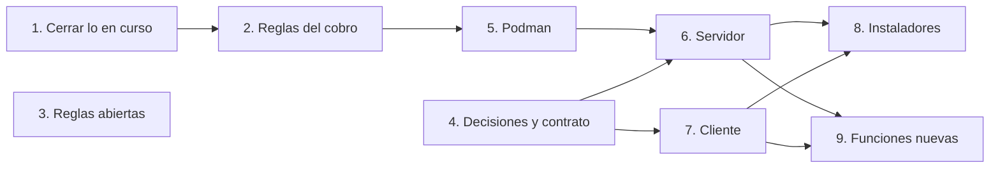

# Pendientes del Sistema de Comandas

Lo que falta para terminar el sistema, dividido en fases. Sirve para ponernos de acuerdo en qué sigue y quién lo hace: cada parte tiene una columna **Responsable** y una casilla para marcarla cuando esté lista.

**Actualizado:** 29 de octubre de 2026

**Hacia dónde va:** el programa en C (memoria compartida, ncurses y archivos de texto) pasa a ser una aplicación con interfaz gráfica para Windows, Linux y Android, **toda en C++ con Qt**.

```
 PC de caja                                       PC y celulares (todos los roles)
┌──────────────────────────────────┐             ┌───────────────────────────────┐
│ Servidor (C++ con Qt)            │  WiFi del   │ App cliente (C++ con Qt)      │
│  · QWebSocketServer + JSON       │◀──salón───▶ │  · Pantallas en QML           │
│  · Lógica que ya está en C       │             │  · Conexión C++ (QWebSocket)  │
│  · QtSql (driver QPSQL)          │             │  · Misma app en PC y Android  │
│        │                         │             └───────────────────────────────┘
│        ▼                         │
│ PostgreSQL 16.4 (Podman)         │
└──────────────────────────────────┘
```

- **Cliente:** una sola app que se compila para Windows, Linux y Android. Cualquier usuario entra desde la PC o desde el celular, según su rol.
- **Servidor:** solo en la PC de caja, junto con la base. Aprovecha la lógica que ya está en C; lo que cambia es cómo se comunica (sockets de Qt en lugar de memoria compartida) y dónde guarda (PostgreSQL en lugar de archivos).

---

## Lo que ya está hecho

| Qué | Dónde |
| :-- | :-- |
| Esquema de 17 tablas, con disparadores, índices, vistas y comentarios | `sql/esquema.sql` |
| Documentación del modelo (EER, reglas de transformación, modelo relacional, diccionario) y diagramas, ya con Saldo | `docs/`, `modelo/` |
| Datos de ejemplo: evento 17 con 3 mesas, 3 cuentas, 5 comandas, un pago con propina y el inventario | `sql/datos-ejemplo.sql` |
| `make -C sql pruebas`: recrea la base de pruebas y corre todo | `sql/Makefile` |
| 23 inserts rechazados, todos pasan | `sql/inserts-rechazados.sql` |
| 12 casos válidos, todos pasan | `sql/pruebas-validas.sql` |
| Máquina de estados de la comanda: solo avanza, se puede cancelar desde cualquier estado y una cancelada ya no cambia | `validar_cambio_estado()` |
| `v_cuenta` con `total_acumulado`, `total_pagado` y `saldo` | `sql/esquema.sql` |
| Prototipo de la interfaz en QML (login, mesero, cocina/bar, admin e ingredientes) | Repo `Sistema-de-Comandas`, `prototipos/qml/` |

## Cómo trabajamos

- **Solo el servidor toca la base.** Ninguna pantalla lee ni escribe en la base directamente.
- **Lo que la base ya protege no se repite en el servidor.** El descuento de stock, la máquina de estados y las reglas del cobro viven en disparadores. Si el servidor también los hace, se hacen dos veces.
- Cada regla nueva de la base lleva tres cosas: su disparador o `CHECK`, un caso en `inserts-rechazados.sql` y un caso en `pruebas-validas.sql`. **Primero el disparador** y después los casos. Si no, el Makefile marca el rechazo como fallido.
- Antes de cada commit, `make -C sql pruebas` debe terminar en `Todas las pruebas pasaron`.
- Numeración: el siguiente rechazo es el **24** y el siguiente caso válido es el **13**.
- Los disparadores lanzan `RAISE EXCEPTION … USING ERRCODE = 'check_violation'`, igual que `fijar_precio_cobrado()`.

## Reparto

| Quién | Qué | Partes |
| :-- | :-- | :-- |
| @Akiodev | Terminar las pruebas de la base: cada regla con su disparador, sus rechazos, su caso válido y su documentación | Fase 2 completa; 3.1, 3.2, 3.4, 3.8 y la regla de 3.3 |
| @Actronix09 | La interfaz y el sistema en QML: el proyecto del cliente, la `Api` simulada y las pantallas | 4.1 y Fase 7 completa |
| Ambos | Lo que afecta a la base y a las pantallas a la vez | Decisiones 3.3, 3.5, 3.6 y 3.7; contrato 4.4–4.7 |

Las fases 5, 6, 8 y 9 se reparten cuando terminen las anteriores.

Para no estorbarnos:
- **Cada quien en su carpeta y en su rama.** @Akiodev trabaja en `sql/` y `docs/`; @Actronix09, en el cliente. Los cambios entran a `main` por PR.
- **Los números de los casos son de @Akiodev.** Como solo una persona agrega rechazos y casos válidos, no hay choques en la numeración.
- **Cada regla nueva se avisa con su mensaje de error.** Cuando una regla de la Fase 2 quede lista (pago mayor que el saldo, cerrar con adeudo, pedir en una cuenta cerrada), @Akiodev pasa el texto del error y @Actronix09 lo agrega a la `Api` simulada. Así la pantalla Caja ya muestra esos errores antes de que exista el servidor, y de ahí salen los códigos de 4.6.

---

## Fase 1: Cerrar lo que está en curso

**Objetivo:** dejar el repo de la base en verde antes de empezar reglas nuevas.
**Depende de:** nada.

| # | Parte | Qué hay que concretar | Hecho cuando | Responsable |
| :--: | :-- | :-- | :-- | :-- |
| 1.1 | - [x] Caso válido 12: pagos parciales | Cuenta propia con Refresco y Pastel (130; la Pasta no sirve porque el caso 1 le sube el precio). Paga 100 → saldo 30; paga 65 con 35 de propina al mesero 1 → saldo 0 y `total_pagado` 130 | `Válidas: 12 de 12` ✓ | |
| 1.2 | - [x] Contadores de los `\warn` | Los `✓ N de 11` pasaron a `de 12` | La salida dice `de 12` ✓ | |
| 1.3 | - [x] Comprobar que el caso detecta el error | Sin la resta de la propina en `v_cuenta`, el caso falla con saldo −35.00 | Comprobado ✓ | |
| 1.4 | - [x] Commit | Caso 12 + contadores | Subido en `e90730e` ✓ | |

---

## Fase 2: Reglas del cobro en la base

**Objetivo:** que la base no deje cobrar de más, cerrar una cuenta con adeudo ni pedir en una cuenta cerrada.
**Depende de:** Fase 1, porque B y C usan el `saldo`.

Decisiones que ya están tomadas:
- `pago.monto` **incluye** la propina: lo que paga el consumo es `monto − monto_propina`.
- Una cuenta puede tener varios pagos.

| # | Parte | Qué hay que concretar | Hecho cuando | Responsable |
| :--: | :-- | :-- | :-- | :-- |
| 2.1 | - [ ] **B:** un pago no excede el saldo | Disparador `BEFORE INSERT` en `pago`: compara `monto − propina` contra el `saldo` de la cuenta. Además, `CHECK (monto_propina <= monto)`. **Rompe el caso válido 8**, que paga 500 en la cuenta "Juancho" sin comandas: hay que agregarle comandas y ajustar el monto | Rechazos: pago mayor que el saldo y propina mayor que el monto. Caso válido: pagar exactamente el saldo |  @Akiodev |
| 2.2 | - [ ] **C:** cerrar una cuenta | Disparador en `cuenta` al pasar a `cerrada`: todas sus comandas deben estar en `entregada` o `cancelada`, y su `saldo` debe ser 0. **Por decidir: quién cierra.** Sugerencia: el cajero, a mano, cuando el saldo llega a 0 | Rechazos: cerrar con comandas pendientes y cerrar con saldo. Caso válido: cerrar "Novios" y abrir otra "Novios" en la misma mesa |  @Akiodev |
| 2.3 | - [ ] **D:** no pedir en una cuenta cerrada | Disparador en `comanda` (`BEFORE INSERT`): la cuenta debe estar `abierta` | Rechazo: comanda en una cuenta cerrada |  @Akiodev |
| 2.4 | - [ ] Documentación | `DiccionarioDeDatos.md`: que `pago.monto` incluye la propina. `ModeloRelacional.md` 6.5 "Reglas del modelo EER": una fila por regla con su rechazo. `ReglasDeTransformacion.md`: sacar estas reglas de "lo que el esquema no puede garantizar" si aparecen ahí | Los documentos coinciden con el esquema |  @Akiodev |
| 2.5 | - [ ] Commit | Una regla por commit | `Rechazados: 28 de 28` aprox. |  @Akiodev |

---

## Fase 3: Reglas abiertas y decisiones del esquema

**Objetivo:** cerrar los huecos que encontró la revisión del esquema y tomar las decisiones que el servidor necesita.
**Depende de:** nada. Puede ir en paralelo con la Fase 2, cuidando la numeración de los casos.

| # | Parte | Qué hay que concretar | Hecho cuando | Responsable |
| :--: | :-- | :-- | :-- | :-- |
| 3.1 | - [ ] `precio_cobrado` siempre del catálogo | Hoy un `INSERT` puede mandar su propio precio. El disparador debe ignorarlo y copiar `producto.precio` | Rechazo o caso válido: el precio enviado se descarta |  @Akiodev |
| 3.2 | - [ ] Nombres únicos sin importar mayúsculas | `LMendez` y `lmendez`, o "Crema" y "crema", hoy pueden existir a la vez. Índice único con `lower()` en `usuario.usuario` e `ingrediente.nombre` | Rechazos con mayúsculas distintas |  @Akiodev |
| 3.3 | - [ ] **Decidir:** estación de cada producto | ¿Sale de `producto.categoria` (alimentos → cocina, bebidas → bar; falta decidir a dónde va `dulceria`) o va en una columna nueva? Después: que el bar no prepare alimentos | Decisión escrita y regla con su rechazo |  Ambos deciden; la regla, @Akiodev |
| 3.4 | - [ ] Evento finalizado | Un evento `finalizado` sigue aceptando comandas. Bloquearlo | Rechazo: comanda en un evento finalizado |  @Akiodev |
| 3.5 | - [ ] **Decidir:** rondas para cocina | ¿Cocina agrupa por cuenta + `fecha_hora` o se crea una entidad `ronda`? | Decisión escrita; si es entidad, tabla y diagramas |  Ambos |
| 3.6 | - [ ] **Decidir:** dónde viven los logs | ¿Tabla de bitácora en la base o archivos en un volumen? | Decisión escrita |  Ambos |
| 3.7 | - [ ] Mínimos que el SQL no hace cumplir | Todo evento con al menos una mesa (*Pertenece*) y todo producto con al menos un ingrediente (*Receta*). ¿Se hacen cumplir en la base o los valida la aplicación? | Decisión anotada en `ReglasDeTransformacion.md` |  Ambos |
| 3.8 | - [ ] *(Opcional)* Capturas de `ModeloRelacional.md` | Las capturas todavía dicen 20 rechazos y 4 comandas. Si el documento es el reporte de la Práctica 3 como se entregó, mejor dejarlo así | Decisión tomada |  @Akiodev |

---

## Fase 4: Decisiones del sistema y contrato de mensajes

**Objetivo:** fijar lo que necesitan el servidor y el cliente para trabajar por separado.
**Depende de:** nada. Se puede hacer mientras avanzan las fases 1–3.

| # | Parte | Qué hay que concretar | Hecho cuando | Responsable |
| :--: | :-- | :-- | :-- | :-- |
| 4.1 | - [ ] **D1:** estilo visual | Probar el prototipo con `./ejecutar.sh Material`, `FluentWinUI3`, `Universal` y `Fusion`, en claro y oscuro | Estilo elegido |  @Actronix09 |
| 4.2 | - [x] **D2:** lenguaje del cliente | **C++ con Qt en todas las plataformas.** Las pantallas en QML; la conexión y el arranque en C++ | Decidido ✓ | |
| 4.3 | - [x] Servidor | **C++ con Qt**, en la PC de caja: `QWebSocketServer` con mensajes JSON, `QtSql` con el driver `QPSQL` y la lógica que ya está en C | Decidido ✓ | |
| 4.4 | - [ ] Contrato de mensajes | Para cada operación (tabla abajo): qué `datos` recibe, qué devuelve, qué errores puede dar y qué rol la puede usar | Documento del contrato en el repo |  Ambos |
| 4.5 | - [ ] Roles y permisos | Mesero → `mesero`. Cocina → `bar_cocina` con estación. Admin → `cajero_admin`: con nivel `cajero` solo cobra y cierra cuentas; con nivel `administrador`, además maneja el catálogo y los usuarios y cancela comandas | Tabla de permisos por operación |  Ambos |
| 4.6 | - [ ] Códigos de error | Cómo se traduce cada error de la base a un código claro. Ejemplo: el `check_violation` de stock → `SIN_STOCK`; una violación de clave única → `YA_EXISTE` | Lista de códigos |  Ambos |
| 4.7 | - [ ] Operaciones nuevas | Las que el sistema en C no tenía y piden el modelo y el prototipo: mesas y cuentas (C5), cobro (C4) y avisos (C11). Ver la segunda tabla | Agregadas al contrato |  Ambos |

**Formato de los mensajes.** Todo viaja como JSON por un solo WebSocket. Cada petición lleva un `id` para emparejarla con su respuesta, y `op` con el nombre de `protocolo.h`:

```json
→ {"id": 7, "op": "OP_CREAR_PEDIDO", "datos": {"numero_evento": 17, "secuencial": 1, "productos": [1, 1, 3]}}
← {"id": 7, "ok": true,  "datos": {"comandas": [41, 42, 43]}}
← {"id": 7, "ok": false, "error": {"codigo": "SIN_STOCK", "mensaje": "No hay stock suficiente de Queso parmesano"}}
← {"aviso": "COMANDA_LISTA", "datos": {"id_comanda": 41, "mesa": 1, "cuenta": "Novios · 17-1-1"}}
```

- Los **avisos** no llevan `id`: el servidor los manda sin que nadie pregunte.
- La **sesión** vive en la conexión: después de `OP_LOGIN`, el servidor recuerda el usuario y el rol de ese socket. Si el celular se desconecta, al reconectar repite el login (o manda un token, si se decide usar uno).
- El **dinero** viaja como texto (`"95.00"`), nunca como número con decimales.

| Operaciones que ya existen en `protocolo.h` | Qué hacen ahora |
| :-- | :-- |
| `OP_LOGIN`, `OP_LOGOUT` | Abrir y cerrar la sesión de la conexión |
| `OP_CREAR_USUARIO`, `OP_VERIFICAR_USUARIO`, `OP_RECUPERAR_PASS` | Alta de usuario, revisar si un nombre está libre y cambiar la contraseña |
| `OP_LISTAR_USUARIOS`, `OP_OBTENER_USUARIO`, `OP_MODIFICAR_USUARIO`, `OP_ELIMINAR_USUARIO` | Administración de usuarios |
| `OP_LISTAR_PRODUCTOS`, `OP_OBTENER_PRODUCTO`, `OP_CREAR_PRODUCTO`, `OP_MODIFICAR_PRODUCTO`, `OP_ELIMINAR_PRODUCTO`, `OP_VERIFICAR_DISPONIBILIDAD_PRODUCTO` | Catálogo con su receta. La disponibilidad sale de la vista `v_producto` |
| `OP_LISTAR_INGREDIENTES`, `OP_OBTENER_INGREDIENTE`, `OP_CREAR_INGREDIENTE`, `OP_MODIFICAR_INGREDIENTE`, `OP_ELIMINAR_INGREDIENTE` | Inventario |
| `OP_CREAR_PEDIDO` | Una lista de productos se vuelve N comandas, **en una sola transacción** |
| `OP_LISTAR_PEDIDOS`, `OP_OBTENER_PEDIDO`, `OP_CAMBIAR_ESTADO_PEDIDO`, `OP_ELIMINAR_PEDIDO` | Comandas y sus estados. `OP_ELIMINAR_PEDIDO` pasa a ser **cancelar**: la base no deja borrar lo que ya se cobró |
| `OP_LISTAR_LOGS`, `OP_VER_LOG` | Bitácora (depende de la decisión 3.6) |

| Operaciones nuevas (propuesta) | Para qué |
| :-- | :-- |
| `OP_LISTAR_MESAS`, `OP_LISTAR_CUENTAS`, `OP_CREAR_CUENTA` | El flujo mesa → cuenta → productos (C5) |
| `OP_REGISTRAR_PAGO`, `OP_CERRAR_CUENTA` | La pantalla Caja (C4) |
| Aviso `COMANDA_CAMBIO` | Cocina/bar y caja ven los cambios sin recargar |
| Aviso `COMANDA_LISTA` | Solo al mesero que levantó la comanda (C11) |

---

## Fase 5: Contenedores con Podman

**Objetivo:** levantar la base del sistema con un solo comando, sin chocar con el contenedor de las prácticas.
**Depende de:** Fase 2, para que el esquema que se monte ya tenga las reglas del cobro.

| # | Parte | Qué hay que concretar | Hecho cuando | Responsable |
| :--: | :-- | :-- | :-- | :-- |
| 5.1 | - [ ] Instalar Podman | `sudo pacman -S podman podman-compose`. Puede convivir con Docker | `podman --version` | |
| 5.2 | - [ ] `compose.yaml` con el servicio `db` | Imagen `docker.io/library/postgres:16.4-alpine`. Proyecto `comandas`, volumen `comandas-pgdata` y puerto `5433:5432`, para no chocar con `practica1-postgres`. `healthcheck` con `pg_isready` | `podman compose up -d` y la base responde en el 5433 | |
| 5.3 | - [ ] Carga inicial | `db/init/` con `esquema.sql` y `datos-ejemplo.sql`, montada en `/docker-entrypoint-initdb.d`. Solo corre con el volumen vacío | La base arranca con datos | |
| 5.4 | - [ ] Credenciales | `.env` fuera de git y `.env.example` de muestra | `.env` en `.gitignore` | |
| 5.5 | - [ ] Pruebas con Podman | `make -C sql pruebas MOTOR=podman` | Todas pasan | |
| 5.6 | - [ ] Arranque automático | Quadlet (systemd) en la PC de caja con Linux, o Podman Desktop en Windows | La base arranca al prender la PC | |

Ojo: `podman compose down -v` borra el volumen con todos los datos.

---

## Fase 6: Servidor (C++ con Qt)

**Objetivo:** el servidor del contrato de la Fase 4, en la PC de caja. Es lo único que toca la base.
**Depende de:** fases 4 y 5.

| # | Parte | Qué hay que concretar | Hecho cuando | Responsable |
| :--: | :-- | :-- | :-- | :-- |
| 6.1 | - [ ] Proyecto | `servidor/` con CMake y Qt 6 (`Core`, `WebSockets`, `Sql`). Los archivos `.c` que se conserven se compilan dentro del proyecto (con `extern "C"` en sus `.h`) | Compila y arranca | |
| 6.2 | - [ ] Conexión con la base | `QSqlDatabase` con el driver `QPSQL` hacia el contenedor (puerto 5433). Datos de conexión desde el `.env` o un archivo de configuración, no en el código | El servidor consulta `v_cuenta` | |
| 6.3 | - [ ] `QWebSocketServer` | Escucha en la red local (`QHostAddress::Any`). Por cada mensaje: leer el JSON, revisar el rol de la conexión y mandarlo a la función de su `op`. Es el `switch` de `Servidor.c`, pero leyendo JSON en lugar de la memoria compartida | Un cliente de prueba hace login y lista productos | |
| 6.4 | - [ ] Lógica en C → PostgreSQL | Pasar cada módulo según la tabla de abajo: lo que leía o escribía archivos ahora hace consultas | Cada operación del contrato funciona | |
| 6.5 | - [ ] Sesión y permisos | Usuario y rol guardados por conexión después de `OP_LOGIN`, **revisados en cada operación**. Contraseñas con Argon2id o bcrypt (por ejemplo con libsodium) en lugar de SHA-256 sin sal; nunca se devuelven al cliente | Un mesero no puede crear usuarios | |
| 6.6 | - [ ] Transacciones y errores | `OP_CREAR_PEDIDO` dentro de `transaction()` / `commit()`, con `rollback()` si falla una comanda. El `SQLSTATE` del error de la base (`QSqlError::nativeErrorCode()`) se traduce a los códigos de la Fase 4 | Pedido con un producto sin stock: no se guarda ninguna comanda y llega `SIN_STOCK` | |
| 6.7 | - [ ] Dinero | Nada de `float`: hoy `productos_agregar` recibe el precio como `float`. Usar texto o centavos enteros (`qint64`) entre la base y el JSON | Precios exactos en todas las respuestas | |
| 6.8 | - [ ] Avisos | Al cambiar una comanda, mandar `COMANDA_CAMBIO` a cocina/bar y caja, y `COMANDA_LISTA` solo a la conexión del mesero que la levantó (C11) | El mesero recibe el aviso en el celular | |
| 6.9 | - [ ] Pruebas | Qt Test contra la base de prueba (`comandas_pruebas`) | Todas pasan | |
| 6.10 | - [ ] Arranque en la PC de caja | Que el servidor arranque solo, después de la base: un servicio de systemd en Linux, o una tarea al iniciar sesión en Windows | Al prender la PC, los celulares se pueden conectar | |

Qué pasa con cada parte del sistema en C:

| Archivo | Qué hace hoy | En el servidor nuevo |
| :-- | :-- | :-- |
| `Servidor.c` | Memoria compartida, semáforos, hilos y un `switch` por `OP_*` | **Se conserva el `switch`** como despachador. La memoria compartida y los semáforos se reemplazan por `QWebSocketServer` |
| `protocolo.h` | Los `OP_*` y los `struct` que viajan por memoria compartida | **Se conservan los nombres `OP_*`**. Los `struct` se reemplazan por JSON |
| `usuario.c`, `usuarios.c` | Usuarios en archivo; `validar_password`; SHA-256 | **Se conserva `validar_password`**. Se quitan `validar_email` y `validar_telefono` (ya no hay correo ni teléfono). Cargar y guardar → SQL. SHA-256 → Argon2id o bcrypt |
| `recuperar_password.c` | Verifica el usuario y aplica la contraseña nueva | Se conserva la lógica, pero el cambio lo autoriza un administrador |
| `productos.c` | Catálogo en archivo; verifica disponibilidad | Consultas a `producto` y `receta`. La disponibilidad sale de `v_producto` |
| `inventario.c` | Stock en archivo; `inventario_actualizar_stock` | Consultas a `ingrediente`. **Se quita el descuento de stock**: lo hace el disparador de `comanda` |
| `pedidos.c` | Pedidos en archivo, con varios productos | `pedidos_crear` → N comandas en una transacción. `pedidos_cambiar_estado` → un `UPDATE`; la base revisa la máquina de estados |
| `logger.c` | Dos hilos que escriben archivos `.log` | Se conserva la idea; el destino depende de la decisión 3.6 |
| `Cliente.c`, `interfaces.c`, `ui.c`, `sesion.c` | Interfaz en ncurses | Se reemplazan por la app en QML (Fase 7) |

Errores del sistema en C que **no** se deben repetir:
- El servidor no revisa quién llama: `OP_CREAR_USUARIO` acepta crear un administrador (`Servidor.c:168`).
- Contraseñas en SHA-256 sin sal, y al editar un usuario desde admin la contraseña se guarda en claro (`interfaces.c:3402`).
- Los listados se cortan en 50 resultados.
- Recuperar la contraseña no verifica la identidad: mejor que el cambio lo haga un administrador.

---

## Fase 7: Cliente real (Qt Quick)

**Objetivo:** la aplicación que usan meseros, cocina/bar y caja.
**Depende de:** las decisiones 4.1 y 4.2 y el contrato 4.4. No hay que esperar a las fases 2 y 3: mientras no esté el servidor, se trabaja con la `Api` simulada del prototipo. La pantalla Caja (7.4) se termina de ajustar cuando estén las reglas 2.1–2.3.

| # | Parte | Qué hay que concretar | Hecho cuando | Responsable |
| :--: | :-- | :-- | :-- | :-- |
| 7.1 | - [ ] Proyecto `cliente/` | CMake + Qt 6 en C++ (`main.cpp` carga el QML; el prototipo ya trae uno en `prototipos/qml/anfitrion/cpp/`). Pasar las pantallas del prototipo que se conserven; el prototipo no se modifica | Arranca en escritorio |  @Actronix09 |
| 7.2 | - [ ] `Api` real | Una clase C++ con `QWebSocket`, registrada como singleton de QML, con la misma interfaz que `ApiSimulada.qml`. Arma los mensajes con `id` y `op`, empareja cada respuesta con su petición y convierte los avisos en señales para las pantallas. La dirección del servidor se guarda con `QSettings` | Las pantallas funcionan contra el servidor sin cambios |  @Actronix09 |
| 7.3 | - [ ] Correcciones del prototipo | Ver la tabla C1–C11 abajo | Cada corrección revisada |  @Actronix09 |
| 7.4 | - [ ] Pantalla **Caja** | Cuentas abiertas → detalle → pagar (forma de pago, monto y propina) → saldo → cerrar cuenta | Cobro completo de una cuenta |  @Actronix09 |
| 7.5 | - [ ] Pantallas adaptables | `readonly property bool compacta: width < 700`. Probar con la ventana en 400×800 | Se usa bien en tamaño de teléfono |  @Actronix09 |
| 7.6 | - [ ] Pantallas pendientes | En orden: 1. Ver logs · 2. Recuperar contraseña · 3. Crear usuario · 4. Admin › Usuarios · 5. Admin › Productos con receta | Las cinco funcionan |  @Actronix09 |
| 7.7 | - [ ] Android | El botón Atrás regresa de pantalla (`pila.pop()`). Al bloquear el teléfono se cae el WebSocket: reconectar y repetir el login al volver (`Qt.application.state`). Hace falta Qt para Android, el SDK, el NDK y el JDK (los paquetes de Arch no compilan para Android) | La app corre en un teléfono conectado al servidor de la PC |  @Actronix09 |
| 7.8 | - [ ] **Decidir:** teclado en pantalla | En escritorio táctil sin teclado. Qt Virtual Keyboard es GPLv3 o comercial, no LGPL; la otra opción es un teclado propio en QML | Decisión tomada |  @Actronix09 |

| # | Corrección del prototipo |
| :--: | :-- |
| C1 | Las órdenes del mesero en tarjetas, no en lista |
| C2 | Lo que está listo para entregar va primero |
| C3 | Tres formas de agrupar: por tiempo, por mesa y cuenta, y por mesero (en mesero, cocina/bar y caja) |
| C4 | Cobro del cajero/administrador (es la pantalla Caja, 7.4) |
| C5 | Primero la mesa, luego la cuenta y al final los productos |
| C6 | La cuenta se muestra con su nombre y el folio al final: "Novios · 17-1-1" |
| C7 | El texto que se sale de algunas tarjetas de producto |
| C8 | Sin atajos de teclado: interfaz táctil o con mouse, botones de 48 px como mínimo |
| C9 | Contenedores con Podman (Fase 5) |
| C10 | La interfaz también en Android (7.7) |
| C11 | Avisar al mesero cuando su orden esté lista (6.8) |

---

## Fase 8: Instaladores

**Objetivo:** que el sistema se instale sin compilar nada.
**Depende de:** Fase 7.

| # | Parte | Qué hay que concretar | Hecho cuando | Responsable |
| :--: | :-- | :-- | :-- | :-- |
| 8.1 | - [ ] Linux | AppImage o `.deb` | Se instala en una máquina limpia | |
| 8.2 | - [ ] Windows | Inno Setup sobre la carpeta que genera `windeployqt` | Probado en una máquina virtual | |
| 8.3 | - [ ] Android | APK firmada con llave propia, instalada directamente en los teléfonos del salón | Instalada en un teléfono | |
| 8.4 | - [ ] Compilación automática | GitHub Actions en `ubuntu-latest` y `windows-latest` | Cada push genera los instaladores | |
| 8.5 | - [ ] Instalación de la PC de caja | Instalador del servidor + guía para levantar la base con Podman, abrir el puerto del servidor en el firewall y anotar la IP que usarán los celulares | Alguien más la sigue sin ayuda | |

---

## Fase 9: Funciones nuevas del modelo

**Objetivo:** lo que el modelo de la base ya permite pero el sistema en C nunca tuvo.
**Depende de:** fases 6 y 7.

| # | Parte | Qué hay que concretar | Hecho cuando | Responsable |
| :--: | :-- | :-- | :-- | :-- |
| 9.1 | - [ ] Eventos y mesas | Alta de eventos y de sus mesas con su mesero | | |
| 9.2 | - [ ] Cuentas y folios | Consulta de cuentas por evento y por mesa | | |
| 9.3 | - [ ] Cancelación de comandas | Pantalla del administrador | | |
| 9.4 | - [ ] Anticipos, paquetes y acuerdos | Registro y consulta | | |
| 9.5 | - [ ] Reportes | Ventas por evento, y consumo real contra lo acordado en el paquete | | |

---

## Qué se puede hacer en paralelo

La base (fases 1–3) y las decisiones del sistema (Fase 4) no dependen una de otra. Una vez escrito el contrato de mensajes, el servidor y el cliente también avanzan por separado: el cliente usa la `Api` simulada hasta que el servidor esté listo.


